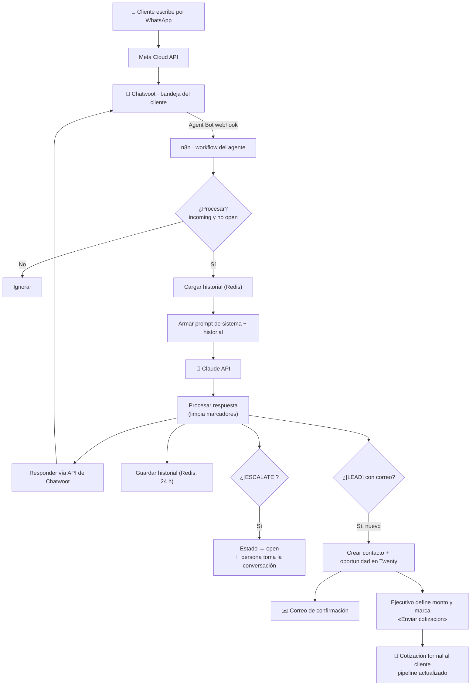

# Arquitectura del agente de WhatsApp

**Última actualización:** 2026-10-26
**Base:** implementación de referencia en producción (cliente de logística), vigente desde julio de 2026, con CRM incorporado en agosto y ampliaciones de marketing y postventa planificadas en septiembre.

> Sin secretos ni identificadores de infraestructura. Ver la nota de seguridad en [`README.md`](./README.md).

---

## 1. Componentes

| Capa | Componente | Rol |
|---|---|---|
| Canal | **Meta WhatsApp Cloud API** (oficial) | Entrada y salida de mensajes. Número del cliente, verificado en Meta con documentos del cliente. |
| Bandeja | **Chatwoot Cloud** (plan con WhatsApp) | Administra el canal. El equipo del cliente ve todas las conversaciones y puede tomarlas. El agente se conecta como *Agent Bot*. |
| Orquestador | **n8n** autoalojado (Docker en VPS, detrás de Caddy con HTTPS) | Workflow del agente: filtra, arma el contexto, llama al modelo, responde, escala y registra. |
| Modelo | **Claude API** (Anthropic) | Genera la respuesta. Modelo de la línea Haiku por costo y latencia; `max_tokens` acotado. |
| Memoria | **Redis** | Historial de la conversación por teléfono, con expiración de 24 h. También marca de lead para evitar duplicados. |
| CRM | **Twenty** | Contacto, oportunidad, pipeline, cotizaciones, motivos de pérdida, remarketing y postventa. |
| Correo | Cuenta del cliente (definitiva pendiente) / **Brevo** (planificado) | Confirmación de solicitud y cotización formal con identidad del cliente; secuencias de seguimiento y remarketing. |
| Encuestas | **Tally** (planificado) | Encuesta de satisfacción de postventa. |

**Principio de diseño (ADR-010):** canal oficial de Meta, nunca conectores no oficiales; la persona del cliente siempre puede tomar la conversación; el CRM es la fuente central de datos comerciales.

---

## 2. Flujo de punta a punta

### Pasos del workflow en n8n

1. **Webhook de Chatwoot** recibe el evento del Agent Bot.
2. **¿Procesar mensaje?** — filtro crítico:
   - `message_type == "incoming"` → **anti-loop obligatorio** (los mensajes del propio agente son `outgoing`).
   - `conversation.status != "open"` → si una persona tomó la conversación, el agente calla.
3. **Cargar historial** desde Redis con la clave `history:{teléfono normalizado}`.
4. **Armar el payload** para Claude: prompt de sistema del cliente + historial + mensaje actual (`body.content`).
5. **Llamar a Claude API.**
6. **Procesar la respuesta:** quitar los marcadores `[ESCALATE]` y `[LEAD]`, normalizar el teléfono y exponer `conversationId`, nombre y mensaje.
7. **Enviar la respuesta** por la API de Chatwoot.
8. **Guardar el historial** en Redis (TTL 24 h).
9. **¿Escalar?** → `toggle_status` a `open`.
10. **¿Es lead?** → verificar en Redis que el número no generó un lead en las últimas 24 h → registrar en el CRM → marcar en Redis.

> **Rama de leads.** En julio el registro iba a un escenario de Make (Google Sheets + correo). Desde agosto el lead se crea en Twenty. Al revisar el workflow, confirmar que la rama de Make quedó desconectada para no duplicar registros.

---

## 3. Traspaso agente ↔ persona

| Estado en Chatwoot | Quién atiende |
|---|---|
| **Pendiente** (`pending`) | 🤖 El agente responde. |
| **Abierta** (`open`) | 👤 Una persona. El agente queda en pausa. |
| **Resuelta** | Conversación cerrada. |

- El agente escala solo cuando su respuesta trae `[ESCALATE]`.
- La persona devuelve la conversación al agente marcándola **Pendiente**.
- La **asignación automática** de la bandeja debe estar **desactivada**: si está activa, Chatwoot abre cada conversación (`open`) y el agente nunca responde.

## 4. Prompt de sistema y marcadores

El prompt de sistema se escribe por cliente y define:

- identidad de la empresa y, si tiene varias unidades, cómo detectar a cuál corresponde la consulta (y hacer venta cruzada);
- el flujo de cotización referencial y qué datos recoger;
- idioma (responde en inglés si le escriben en inglés);
- estilo: **usted**, breve, sin markdown (WhatsApp no lo renderiza);
- derivaciones fijas (por ejemplo, CV a un correo de RR. HH.);
- límites de política: montos o tramos que siempre van a una persona;
- los marcadores:

| Marcador | Cuándo lo agrega el agente | Efecto |
|---|---|---|
| `[ESCALATE]` | Urgencia, reclamo, caso fuera de política (p. ej. mercancía peligrosa o montos sobre el tramo autorizado) o pedido de hablar con una persona. | Estado `open` + alerta al equipo. |
| `[LEAD]` | Intención comercial real (un «hola» no cuenta). | Registro en el CRM con deduplicación por número. |

Los marcadores se eliminan antes de enviar la respuesta al cliente.

## 5. CRM y cotización (Twenty)

- **Registro automático:** cuando el cliente entrega su correo, se crean el contacto y la oportunidad con los datos capturados en la conversación (servicio, ruta, tipo de carga, valor estimado o equivalentes del rubro).
- **Confirmación:** correo automático con identidad del cliente.
- **Cotización formal:** el ejecutivo completa monto y condiciones en la oportunidad y marca **«Enviar cotización»**. El sistema genera vista previa, folio y PDF, envía el correo, guarda en Drive, deja registro y actualiza el pipeline. **Nada sensible sale sin esa aprobación.**
- **Dashboard de marketing:** ganadas, perdidas, montos (con moneda explícita), servicio, responsable, fuente y unidad comercial.
- **Motivos de pérdida** (uno principal, «Otro» exige observación): precio, eligió otra empresa, sin respuesta, postergado, cancelado, plazo, condiciones comerciales, servicio no disponible, documentación incompleta, contacto no calificado, otro.

**Reparto de responsabilidades:** el cliente genera y mantiene la información operativa (completar campos, cerrar oportunidades con motivo). Interforma configura, automatiza, monitorea y convierte esos datos en comunicaciones, seguimiento e indicadores.

## 6. Seguimiento, remarketing y postventa (en preparación)

| Pieza | Diseño | Estado |
|---|---|---|
| Seguimiento a leads sin respuesta | Recordatorios a los 15, 30 y 45 días; la secuencia se detiene en cuanto el cliente responde. | 🟡 Diseñado, sin activar |
| Remarketing | Segmentos por motivo de pérdida, solo contactos autorizados; contenido de valor; se detiene ante respuesta o nueva oportunidad. Twenty → n8n → Brevo. | 🟡 Vista creada |
| Postventa | Objeto en Twenty vinculado a la oportunidad ganada. Estados: Pendiente → Servicio en curso → Servicio finalizado → Encuesta programada → Enviada → Respondida → Seguimiento requerido → Cerrada. | 🟡 Estructura creada; operación manual primero |
| Encuesta | Nota general 1–5, atributos (claridad, rapidez, comunicación, plazos, atención), recomendación 0–10, nueva necesidad y autorización de testimonio. Twenty → Brevo → Tally → Twenty. | 🟡 Propuesta, pendiente de aprobación |
| Alerta de insatisfacción | Nota 1–3 o reclamo crea una tarea urgente con responsable designado. | ⬜ Pendiente |

**Orden acordado:** validar el proceso manual con 2–3 oportunidades ganadas antes de automatizar; después encuesta, remitente, Brevo, integración n8n, pruebas internas y piloto controlado.

---

## 7. Seguridad y datos

- **Secretos** (API keys de Claude y Chatwoot, token permanente de Meta, credenciales de Redis y n8n) solo en los nodos de n8n, el gestor de secretos o el `.env` del servidor. Nunca en Notion, en capturas ni en este repo.
- **Los JSON exportados de n8n contienen credenciales en texto plano.** Tratarlos como archivos sensibles: no se suben a ningún repositorio. Para editarlos con Claude Code se usa una carpeta local fuera de git, con el último export siempre llamado `agente-actual.json`.
- **Rotar** cualquier clave que aparezca en una captura o en un chat.
- **Servidor:** acceso por llave SSH (no contraseña root), autenticación de n8n con contraseña fuerte, solo puertos 80/443 expuestos.
- **Normativa chilena:** el servicio se ofrece alineado con la Ley 19.628 y la Ley 21.719 de protección de datos personales: finalidad definida para cada dato, trazabilidad de cada acción del agente, acceso controlado y remarketing solo con contactos autorizados. El historial en Redis expira a las 24 h.
- **Meta:** la verificación del negocio se hace con documentos del cliente, no de Interforma. Requiere política de privacidad, términos y URL de eliminación de datos publicadas en el sitio del cliente.

## 8. Lecciones operativas (para depurar)

1. **Si ves mensajes repitiéndose, desactiva el workflow de inmediato.** Es un loop por falta del filtro `incoming` y consume créditos del modelo.
2. **Chatwoot envía varios eventos por mensaje** (`message_created`, `message_updated`, cambios de estado). En n8n verás varias ejecuciones por cada mensaje real; la que importa es la que pasa el filtro.
3. **Las claves de Redis de *cargar* y *guardar* deben ser idénticas.** Un desajuste hace que el historial no persista y el agente salude en cada mensaje. Fue la causa raíz de la «rigidez» inicial.
4. **El nodo Redis Get expone el valor en el campo definido en «Name».** El nodo siguiente debe leer ese mismo nombre.
5. **Texto del modelo dentro de JSON:** usar `{{ JSON.stringify($json.campo) }}` sin comillas manuales para no romper el payload con saltos de línea.
6. **Formato de entrada de Chatwoot:** mensaje en `body.content`, teléfono en `body.sender.phone_number` (con `+`, normalizar), conversación en `body.conversation.id`, estado en `body.conversation.status`.
7. **Probar siempre con un número que nunca haya escrito** para confirmar que una conversación nueva entra en `pending` y la atiende el agente.
8. **Regla para escalar:** no romper lo que funciona. Cambios aditivos primero, workflow nuevo en paralelo y switch controlado (desactivar el viejo, activar el nuevo, conservar el anterior como respaldo).

## 9. Historia de la arquitectura

| Etapa | Arquitectura | Por qué se dejó |
|---|---|---|
| 1 | Conector no oficial de WhatsApp Web (Evolution API) → n8n | Números con privacidad activada llegaban mal formateados; inestable. |
| 2 | Meta Cloud API directo a n8n | Estable, pero el número salió de los teléfonos y el equipo no podía responder manualmente. |
| 3 (vigente) | Meta Cloud API → Chatwoot → n8n como Agent Bot | Agente y personas comparten la misma bandeja. |
| 3 + CRM (ago 2026) | + Twenty para leads, confirmación y cotización aprobada | Que ningún lead se pierda y la cotización salga con aprobación. |

## 10. Mejoras evaluadas

- Pausas naturales e indicador «escribiendo» (nodo Wait) para que la conversación se sienta humana.
- Botones nativos de WhatsApp solo para el menú de servicios (modelo híbrido con la IA conversacional).
- Notificaciones de Chatwoot (correo o push) para conversaciones nuevas y escalamientos.
- Etiquetas, respuestas predefinidas e informes de Chatwoot.
- Agregar asientos de Chatwoot a medida que se sume el equipo.
- *(Propuesta, no evaluada aún)* Plantilla reutilizable del workflow (prompt y campos parametrizados por cliente) para acortar la puesta en marcha de nuevos pilotos, incluido el agente propio de Interforma.
